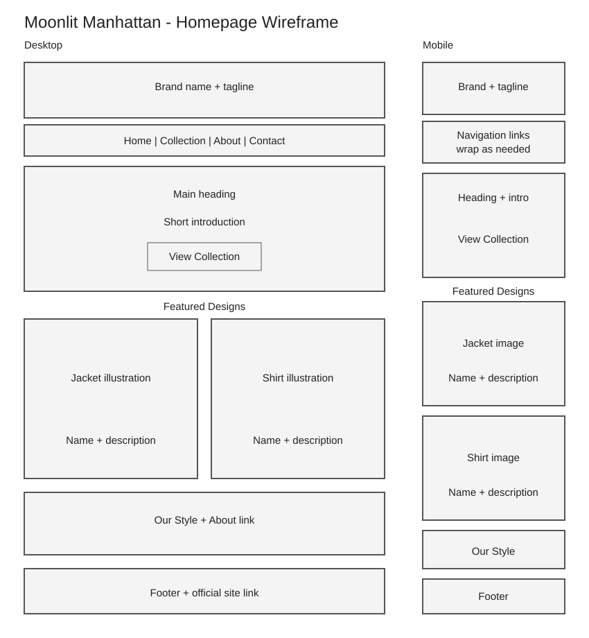

# Moonlit Manhattan - Website From Scratch

## Project overview

For this project, I chose Moonlit Manhattan, a clothing brand I am working on. I already have a website for the business, so this is a separate version for class. I kept it simple with four pages, a few clothing designs, and basic JavaScript.

## Part 1: Content

### 1. What is the name of your business?
Moonlit Manhattan.

### 2. Is the business real or fictional?
It is a real clothing brand I am developing. My current website is https://moonlitmanhattan.com/. This version is separate for the class project.

### 3. What products or services does the business offer?
I am working on clothing designs, including a leather jacket, a long-sleeve shirt, a leather-accent hoodie, and a gothic henley.

### 4. Who is the target audience?
My target audience is young adults around ages 18-30 who like streetwear, darker colors, and simple branding.

### 5. What problem does this business solve?
I want to offer clothing that stands out through its details without needing a large logo on the front.

### 6. What makes this business unique compared to competitors?
What makes my brand different is the way I combine a New York night-time feel with gothic details. I mainly use black, with small red accents and subtle hardware.

### 7. What pages will your website include?
Home, Collection, About, and Contact.

### 8. Write a short mission statement.
My mission is to make clothing that feels dark, simple, and different, while still being easy to wear.

### 9. What tone should the website content have?
I want the writing to sound modern and professional, but still simple and easy to understand.

### 10. What call-to-action do you want visitors to take?
I want visitors to click View the Collection. Visitors can also learn about the brand and try the contact form.

### 11. What information must be immediately visible on the homepage?
The business name, tagline, navigation, a brief explanation of the clothing brand, and a button leading to the collection.

### 12. Will the site include images, videos, or other media? Why?
I included simple illustrations of the four clothing designs so visitors can see the general idea. These are concept images, not actual product photos. I did not include video because the site does not need it.

## Part 2: Design

### 1. What overall style will the website have?
I chose a simple layout with a dark header, a light background, and two product cards in each row.

### 2. What color scheme will you use and why?
Black (#171717) and dark gray (#303030) reflect the brand. Off-white (#f6f4f1) and white improve readability. Dark red (#702731) highlights buttons and links without overwhelming the design.

### 3. What fonts will you use for headings and body text?
I used Georgia for headings and Arial for the rest of the text. They are easy to read and work without downloading extra fonts.

### 4. How will spacing and layout improve readability?
The content has a maximum width of 1000 pixels, with padding around sections. Product cards have gaps between them. Body text uses a line height of 1.6.

The supplied assignment skips question 5; the numbering below follows it.

### 6. What visual hierarchy will guide the user's attention?
The brand name comes first, followed by the homepage heading, a short introduction, and the collection button. Section headings and product images guide visitors through the remaining content.

### 7. How will consistency be maintained across pages?
Every page uses the same header, navigation, footer, colors, and shared stylesheet. Buttons, headings, and spacing follow the same styles.

### 8. What icons will you use?
I did not use icons. I used text links and buttons so visitors can easily tell what each option does.

### 9. What emotions should the design evoke?
I want the site to feel confident and simple, with a darker style that matches the brand.

### 10. How will accessibility be considered?
The site uses semantic HTML, meaningful image descriptions, visible form labels, readable text, strong contrast, keyboard focus outlines, a skip link, and current-page navigation indicators. Form errors appear as text and are connected to their fields. Filter buttons expose their selected state. Feedback uses a live status region. No animation is used.

### 11. What inspiration sources influenced your design?
The existing Moonlit Manhattan website influenced the business content and color direction. The class version uses a simpler original layout and newly written HTML, CSS, and JavaScript. No existing site source code or commercial template was copied.

### 12. Describe the homepage layout and build the wireframe.
The homepage begins with a centered brand header, followed by navigation. The main area contains an introduction and collection button, two featured design cards, and an Our Style section. A footer ends the page. On small screens, the cards stack into one column and navigation links wrap.



[Open the wireframe](wireframe.svg)

## Part 3: Interactivity

### 1. What interactive elements will your site include?
Navigation links, a collection button, three collection filter buttons, and a contact form with a submit button.

### 2. How will users navigate the website?
The navigation bar links to all four pages. It appears on every page and wraps on narrow screens. The homepage collection button provides another route to the product showcase.

### 3. Will there be form validation or user feedback?
Yes. JavaScript checks for a name, a valid email address, and a message with at least 10 characters. Invalid fields receive text feedback and an invalid-state attribute. The first invalid field receives focus. Valid entries produce a clear demonstration message. The form does not send, store, or email any information.

### 4. What JavaScript functionality will you implement?
A collection filter uses loops, if-else statements, event listeners, and data attributes. Form validation uses an event listener, string checks, and the browser's email validity property.

### 5. How does interactivity improve user experience?
Filters help visitors focus on tops or outerwear. Validation explains what needs correction before a form could be submitted. Neither feature requires a page reload.

## Target audience

The content and collection focus on young adults interested in dark streetwear. Plain language and simple navigation also make the site usable for visitors unfamiliar with the brand.

## Content strategy

I kept the descriptions short and focused on the brand and clothing designs. I left out prices and shopping features because this project is a showcase. The contact form is clearly marked as a demo.

## Information organization

| Page | Main content | Visitor action |
| --- | --- | --- |
| Home | Introduction, two featured designs, Our Style | View collection |
| Collection | Four designs and category filters | Explore products |
| About | Business background, mission, audience | Understand the brand |
| Contact | Demo form and official website link | Test form validation |

## Visual design

The wireframe above shows the planned desktop and mobile layout. The site uses a black header, off-white background, dark red buttons, and consistent product cards. Below 600 pixels, the two-column grid becomes one column. Content remains readable without fixed page widths.

## Interaction / functionality

- All navigation links use relative paths for GitHub Pages compatibility.
- All, Outerwear, and Tops buttons hide or show matching collection cards.
- Filter feedback displays how many designs are visible.
- Contact validation reports missing or invalid entries.
- Form information is never transmitted or saved.
- With JavaScript disabled, all products and navigation remain visible, but filtering and custom form validation are unavailable.

## Technical overview

Plain HTML, CSS, and JavaScript are used. There is no framework, package installation, backend, database, checkout, or external API. The site can be hosted as static files on GitHub Pages.

```text
index.html       Home page
collection.html  Collection page
about.html       About page
contact.html     Contact page
style.css        Shared styling and mobile media query
script.js        Filters and contact form validation
wireframe.svg    Desktop and mobile homepage plan
images/          Four original SVG concept illustrations
README.md        Design document
STUDY-GUIDE.md   Basic explanation and manual testing steps
.nojekyll        Tells GitHub Pages to serve static files directly
```

## Timeline / project milestones

I organized the project into these main steps:

| Milestone | Work |
| --- | --- |
| 1. Planning | Choose business, answer questions, and create wireframe |
| 2. Structure | Build the four HTML pages and navigation |
| 3. Styling | Add shared CSS and responsive layout |
| 4. Interactivity | Implement filters and form validation |
| 5. Testing | Check links, keyboard access, mobile layout, and JavaScript |
| 6. Submission | Upload files to GitHub, enable Pages, and submit both URLs |

## External resources and assistance

- Existing brand website and business reference: https://moonlitmanhattan.com/
- MDN HTML reference: https://developer.mozilla.org/en-US/docs/Web/HTML
- MDN CSS reference: https://developer.mozilla.org/en-US/docs/Web/CSS
- MDN JavaScript reference: https://developer.mozilla.org/en-US/docs/Web/JavaScript
- GitHub Pages setup: https://docs.github.com/en/pages/getting-started-with-github-pages/creating-a-github-pages-site
- I used ChatGPT for help with the planning, draft code, concept illustrations, and explanations.

No third-party photographs, fonts, icon libraries, or website templates are included. The SVG illustrations were created specifically for this project. The existing brand website is a content reference, not a source-code template.

## Run locally

Extract the folder and open index.html in a web browser. No installation is required.

## Publish on GitHub Pages

1. Sign in to GitHub and create a public repository, for example moonlit-manhattan-class.
2. Upload the contents of this project folder to the repository root. Upload the images folder with its files. Do not upload just the ZIP.
3. Commit the upload to the main branch.
4. Open Settings > Pages.
5. Under Build and deployment, choose Deploy from a branch. Select main and / (root), then Save.
6. Wait for the deployment to finish. Use the website address displayed by GitHub Pages.
7. Open the deployed site and check all four pages before submitting.
8. Submit the repository URL and the GitHub Pages website URL on Brightspace.

This project is independent of moonlitmanhattan.com. Do not change that domain's DNS settings or add a CNAME file.
